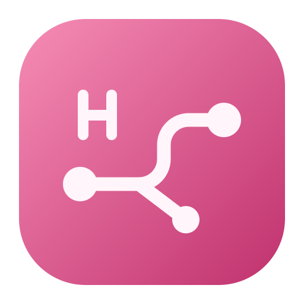

<div align="center">
  
  <h1>Hello TSNet</h1>
  <p>macOS のメニューバーから Tailnet のデバイスにアクセス。</p>
  <p><a href="../README.md">English</a> · <a href="README.zh-CN.md">简体中文</a> · <a href="README.zh-TW.md">繁體中文</a> · 日本語 · <a href="README.es.md">Español</a></p>
</div>

Hello TSNet は [Tailscale tsnet](https://tailscale.com/docs/features/tsnet) を組み込み、ノードとして Tailnet に参加します。ネイティブのコントロールパネルには、ローカルアドレス、参照可能なデバイス、接続状態が表示されます。

- **Tailnet のデバイスにアクセス。** オプションのルーティングヘルパーが IPv4 と IPv6 のホストルートを同期します。デバイスの Tailnet IP、完全な `.ts.net` 名、または `.local` エイリアスを、サービス本来のポートと組み合わせて使えます。
- **ローカルサービスを Tailnet に公開。** [Tailnet のアクセスポリシー](https://tailscale.com/docs/features/access-control/grants) で許可された TCP と UDP の接続を、`127.0.0.1` の同じポートに転送します。
- **接続を管理。** パネルでデバイスを検索し、アドレスや名前をコピーできます。サインイン、サインアウト、ヘルパーの管理も行えます。

## ビルドとインストール

macOS 15 以降、Go 1.27.1 以降、Python 3、Xcode Command Line Tools が必要です。このリポジトリをクローンし、ルートディレクトリで次のコマンドを実行します。

```bash
./scripts/build-app.sh
python3 scripts/install-app.py
```

インストーラーはアプリを `/Applications/Hello TSNet.app` に配置して起動します。メニューバーで「授权登录」（サインイン）を選び、ブラウザーで Tailscale の認証を完了してください。

「安装路由助手…」（ルーティングヘルパーをインストール）を選び、macOS の管理者認証を行うと、IP や名前で直接アクセスできます。ヘルパーの更新と削除は「控制面板 → 设置」（コントロールパネル → 設定）から行えます。一般公開前のヘルパーを使用している場合は、旧アプリから削除してから公開版をインストールしてください。

## ルーティングと名前解決

アプリは現在のユーザー権限で動作します。ヘルパーは launchd の Unix ソケットを介して仮想インターフェースと Tailnet デバイスのホストルートを設定します。名前の対応は `/etc/hosts` の専用ブロックに記録されます。既存のエントリーが優先され、重複して区別できない `.local` エイリアスは省略されます。アプリの終了時またはサインアウト時に、ヘルパーがルートと専用ブロックを削除します。

## 開発

```bash
go test -race ./...
go vet ./...
go build ./cmd/hello-tsnet
./scripts/test-menubar.sh
```

構成と手動ネットワークテストについては、[メンテナー向けメモ](HANDOFF.md)を参照してください。

## ライセンス

[MIT](../LICENSE)。Hello TSNet は Tailscale の tsnet ライブラリを使用する独立したプロジェクトです。
