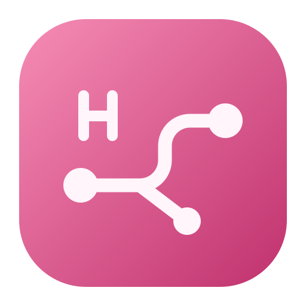

<div align="center">
  
  <h1>Hello TSNet</h1>
  <p>在 macOS 菜单栏访问 Tailnet 设备。</p>
  <p><a href="../README.md">English</a> · 简体中文 · <a href="README.zh-TW.md">繁體中文</a> · <a href="README.ja.md">日本語</a> · <a href="README.es.md">Español</a></p>
</div>

Hello TSNet 通过内置的 [Tailscale tsnet](https://tailscale.com/docs/features/tsnet) 作为节点加入 Tailnet。原生控制面板显示本机地址、可见设备和连接状态。

- **访问 Tailnet 设备。** 可选的路由助手会同步 IPv4 和 IPv6 主机路由。使用设备的 Tailnet IP、完整 `.ts.net` 域名或 `.local` 别名，连接原服务端口。
- **让 Tailnet 访问本机服务。** [Tailnet 访问策略](https://tailscale.com/docs/features/access-control/grants) 允许的 TCP 和 UDP 连接会转发到本机 `127.0.0.1` 的同号端口。
- **管理连接。** 在原生面板中搜索设备、复制地址和名称、登录或退出，以及管理助手。

## 下载和安装

从 [GitHub Releases](https://github.com/AielloChan/hello-tsnet/releases/latest) 下载 DMG。Apple 芯片选 **arm64**，Intel 芯片选 **x86_64**。打开磁盘映像，把 Hello TSNet 拖到「应用程序」。需要 macOS 15 或更新版本。

发布包使用临时签名。首次打开若被 macOS 拦截，可在「隐私与安全性」中选择「仍要打开」。[Apple 操作说明](https://support.apple.com/zh-cn/102445)

## 从源代码构建

需要 macOS 15 或更新版本、Go 1.27.1 或更新版本、Python 3 和 Xcode Command Line Tools。克隆仓库后，在根目录运行：

```bash
./scripts/build-app.sh
python3 scripts/install-app.py
```

安装器将应用放到 `/Applications/Hello TSNet.app` 并打开。

## 登录和配置直连

点菜单栏里的「授权登录」，在浏览器完成 Tailscale 授权。

点「安装路由助手…」并完成 macOS 管理员授权，即可通过 IP 和名称直连设备。后续可在「控制面板 → 设置」更新或卸载助手。如果装过公开版之前的助手，请先从旧版应用卸载它，再安装公开版。

## 路由和名称解析

应用以当前用户身份运行。助手通过 launchd 的 Unix socket 配置虚拟网卡和 Tailnet 设备的主机路由。名称映射写在 `/etc/hosts` 的标记区块中，已有条目优先，存在歧义的 `.local` 别名会跳过。退出应用或退出登录时，助手释放路由并清理该区块。

## 开发

```bash
go test -race ./...
go vet ./...
go build ./cmd/hello-tsnet
./scripts/test-menubar.sh
```

项目架构与网络验收步骤见[研发交接](HANDOFF.md)。

## 许可证

[MIT](../LICENSE)。Hello TSNet 是使用 Tailscale tsnet 库的独立项目。
