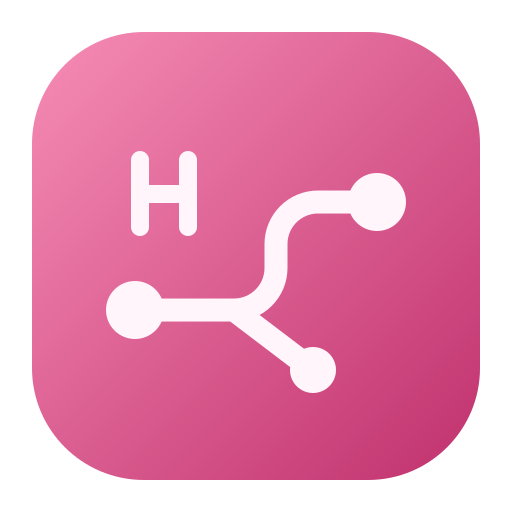

<div align="center">
  
  <h1>Hello TSNet</h1>
  <p>從 macOS 選單列存取 Tailnet 裝置。</p>
  <p><a href="../README.md">English</a> · <a href="README.zh-CN.md">简体中文</a> · 繁體中文 · <a href="README.ja.md">日本語</a> · <a href="README.es.md">Español</a></p>
</div>

Hello TSNet 內建 [Tailscale tsnet](https://tailscale.com/docs/features/tsnet)，以節點身分加入 Tailnet。原生控制面板會顯示本機位址、可見裝置與連線狀態。

- **存取 Tailnet 裝置。** 選用的路由輔助程式會同步 IPv4 和 IPv6 主機路由。使用裝置的 Tailnet IP、完整 `.ts.net` 網域名稱或 `.local` 別名，連線至原服務連接埠。
- **讓 Tailnet 存取本機服務。** [Tailnet 存取政策](https://tailscale.com/docs/features/access-control/grants) 允許的 TCP 和 UDP 連線會轉送到本機 `127.0.0.1` 的同號連接埠。
- **管理連線。** 在原生面板中搜尋裝置、複製位址和名稱、登入或登出，以及管理輔助程式。

## 建置與安裝

需要 macOS 15 或更新版本、Go 1.27.1 或更新版本、Python 3 和 Xcode Command Line Tools。複製此儲存庫後，在根目錄執行：

```bash
./scripts/build-app.sh
python3 scripts/install-app.py
```

安裝程式會將應用程式放在 `/Applications/Hello TSNet.app` 並開啟。選擇選單列的「授权登录」，在瀏覽器完成 Tailscale 授權。

選擇「安装路由助手…」並完成 macOS 管理員授權，即可透過 IP 和名稱直接存取裝置。日後可在「控制面板 → 设置」更新或移除輔助程式。若已安裝公開版之前的輔助程式，請先從舊版應用程式移除，再安裝公開版。

## 路由與名稱解析

應用程式以目前使用者的身分執行。輔助程式透過 launchd 的 Unix socket 設定虛擬網路介面與 Tailnet 裝置的主機路由。名稱對應寫在 `/etc/hosts` 的標記區塊中，既有項目優先，有歧義的 `.local` 別名會略過。結束應用程式或登出時，輔助程式會釋放路由並清除該區塊。

## 開發

```bash
go test -race ./...
go vet ./...
go build ./cmd/hello-tsnet
./scripts/test-menubar.sh
```

架構與手動網路驗證步驟請見[維護說明](HANDOFF.md)。

## 授權條款

[MIT](../LICENSE)。Hello TSNet 是使用 Tailscale tsnet 函式庫的獨立專案。
